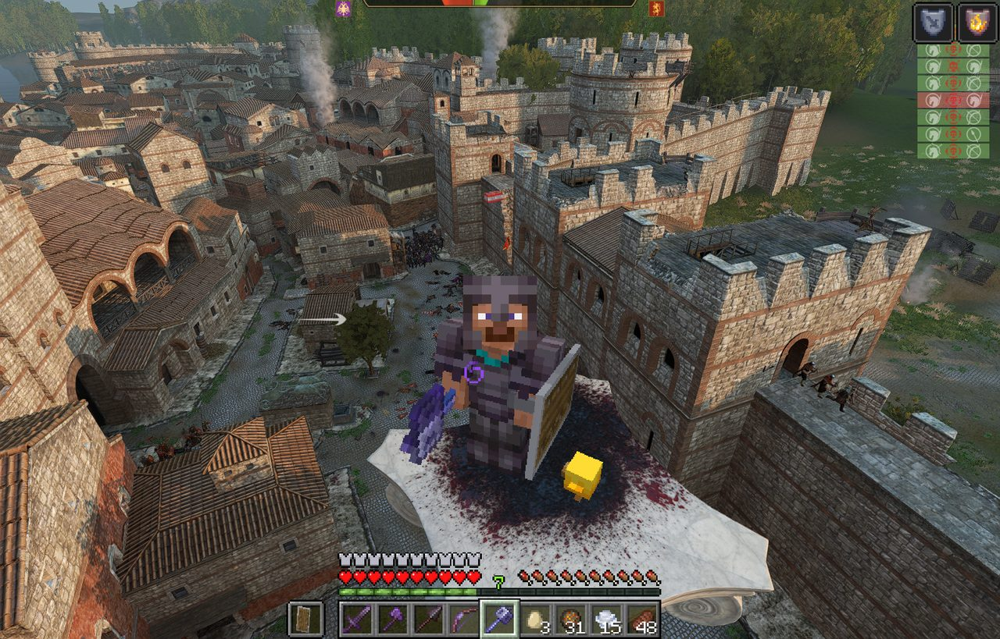
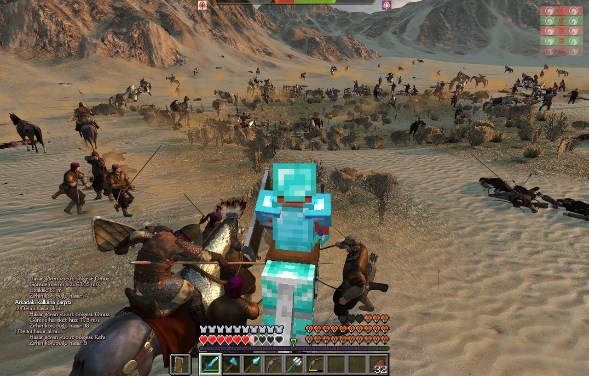
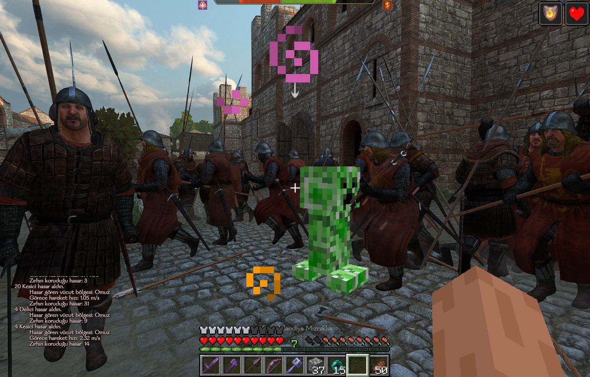
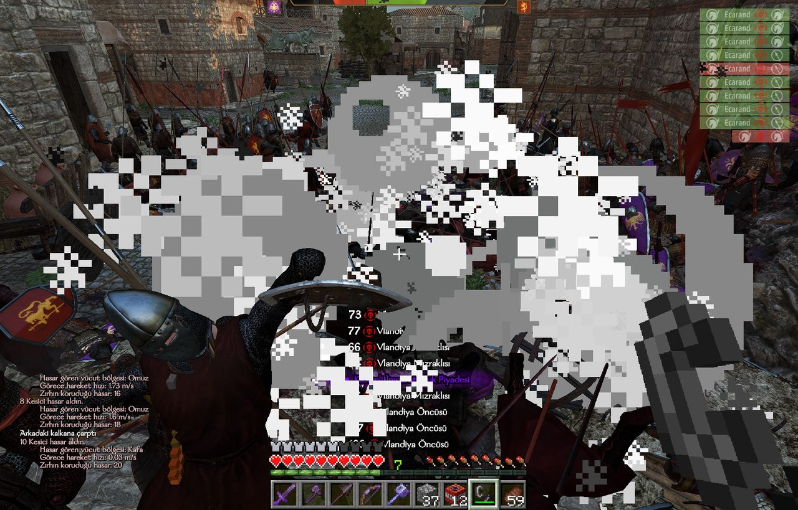
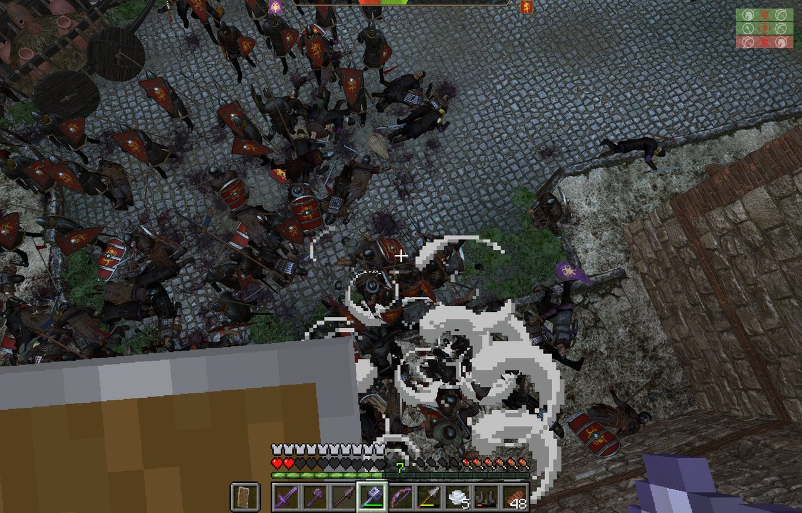
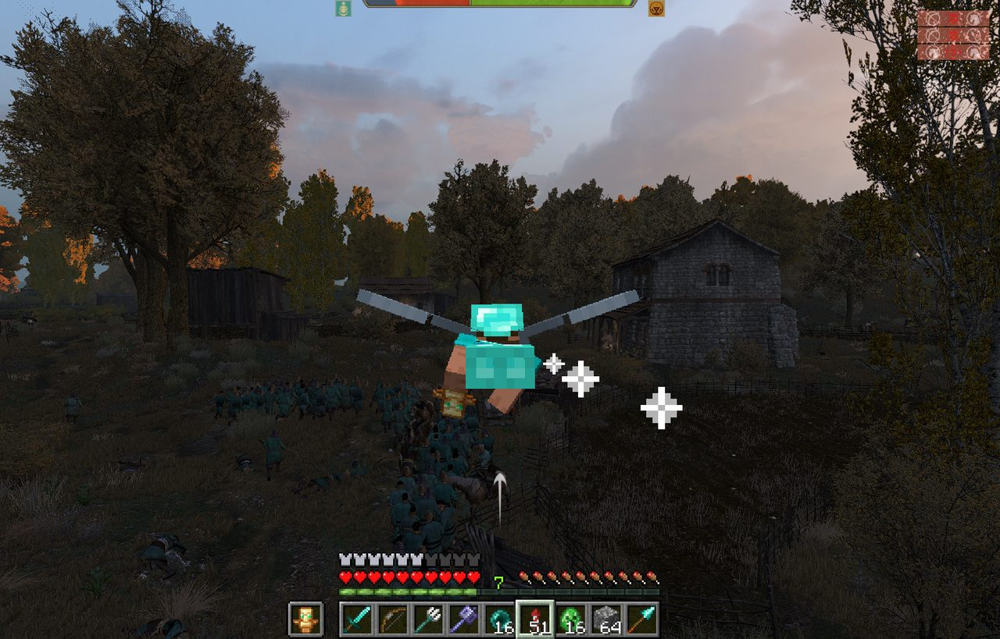
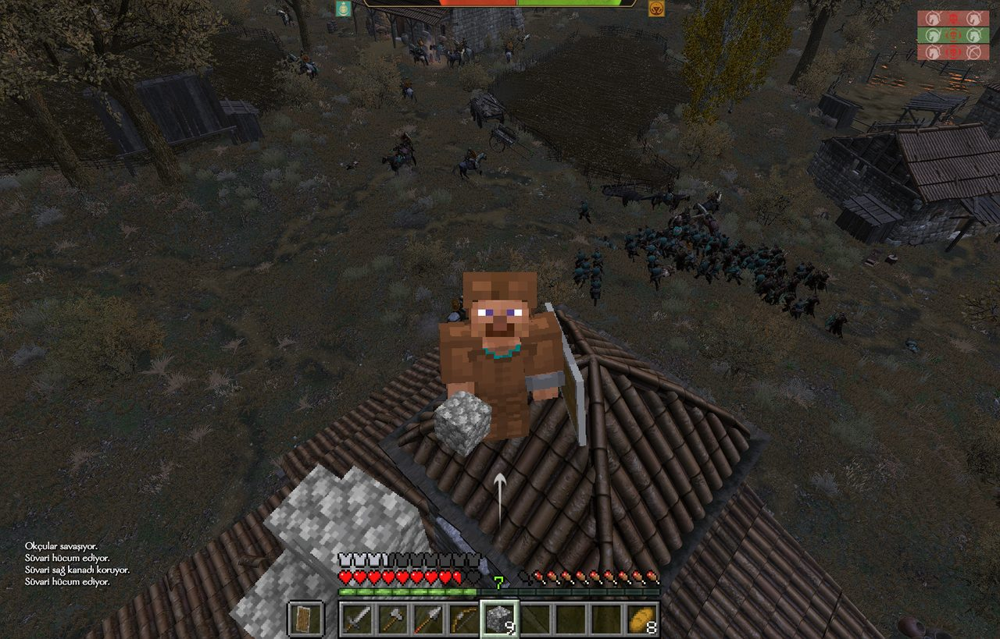
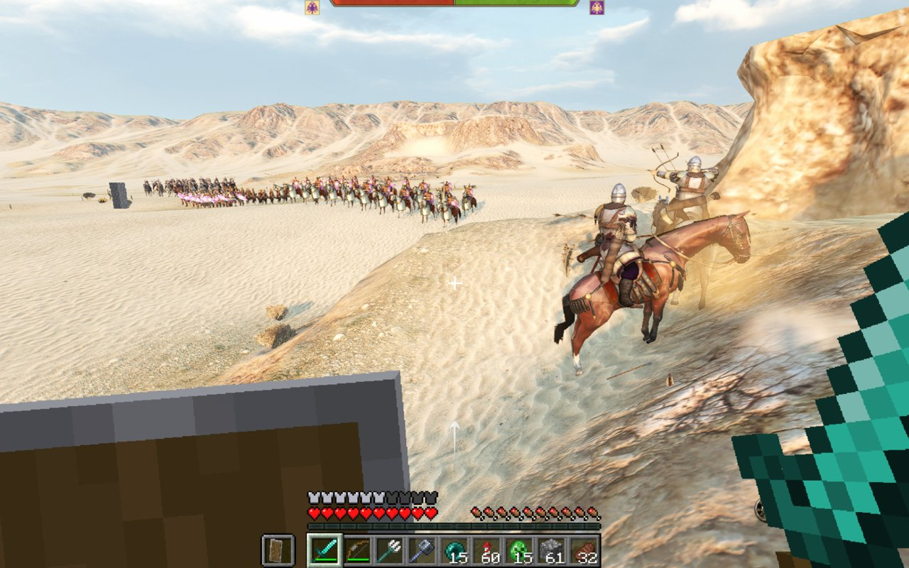
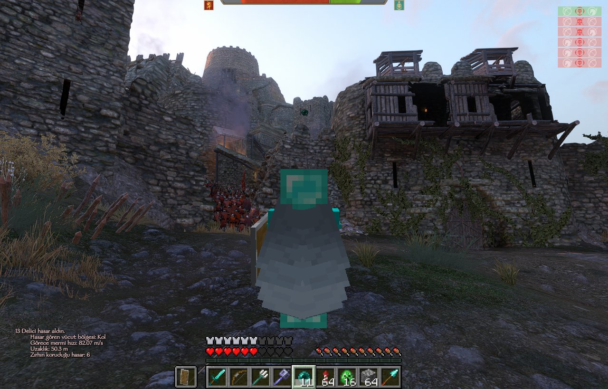
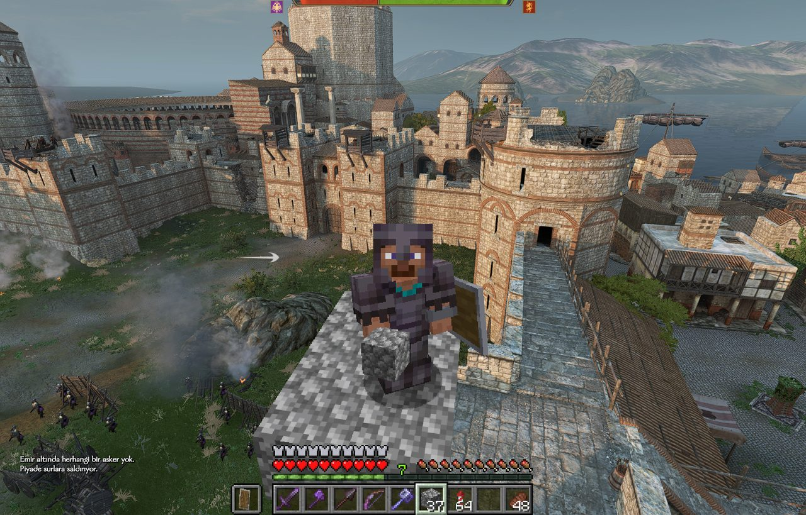

# Bannerlord × Minecraft Passthrough

[English](README.md) · **Türkçe**

Yapan: **Emre Türksoy** · [Psicodart Games Discord](https://discord.gg/R4qStgw9bk)

Bu mod Minecraft'taki Steve'i *Mount & Blade II: Bannerlord* savaşlarına sokuyor. İki oyun yan yana
çalışıyor ve paylaşımlı bellek üzerinden sürekli haberleşiyor. Bannerlord'un penceresinde
oynuyorsun ama klavye ve fare gerçek Minecraft oyuncusunu yönetiyor; hareket, elytra, eşyalar,
envanter ve dövüş Minecraft'ın kurallarıyla işliyor. Bannerlord, Minecraft'ın kamerasından çiziyor,
Steve de sahneye derinliğiyle birlikte yerleşiyor: önünde bir asker varsa Steve onun arkasında
kalıyor.



| | |
|---|---|
|  |  |
|  |  |
|  |  |

## Neler yapıyor

- **Steve senin karakterin.** Bannerlord'daki klavye ve fare Minecraft'a gidiyor: Steve yürüyor,
  koşuyor, eğiliyor, yüzüyor, süzülüyor, inci atıyor, yemek yiyor, kalkanla korunuyor; hepsi
  Minecraft'taki gibi. Bannerlord karakterin görünmez, sessiz bir vekile dönüşüp Steve'i takip
  ediyor, düşman da onunla savaşıyor.
- **Tek kamera.** Bannerlord savaşı Minecraft'ın kamerasından çiziyor: birinci şahıs (Minecraft'ın
  eliyle) ya da üçüncü şahıs (F5).
- **Minecraft dövüşü, Bannerlord sonuçları.**
  - Steve'in yakınındaki her askerin Minecraft'ta görünmez bir kopyası var. Kılıç, sweep, mızrak,
    ok, trident ve mace bu kopyaya Minecraft'ın kendi kurallarıyla vuruyor (bekleme süresi, kritik,
    mace smash), hasar da gerçek askere işliyor.
  - Kendi askerlerine zarar vermiyorsun; okların ve incilerin içlerinden geçiyor.
  - Vurduğun askerler Minecraft yaratıkları gibi kırmızı yanıp sönüyor.
  - Düşmanın sana vuruşları Minecraft'ta uygulanıyor; zırhın, kalkanın ve totemin işe yarıyor.
  - Savaşa atla girersen Steve zırhlı bir Minecraft atına biniyor. Alçaktan gelen darbeler atı
    vuruyor.
  - Steve ölürse Bannerlord karakterin de ölüyor.
- **Ortak dünya.**
  - Steve'in çevresindeki zemin ve duvarlar Minecraft'ta görünmez bariyer bloklarıyla yeniden
    kuruluyor, Steve de Bannerlord'un arazisinde yürüyor. Bir bloğu zıplamadan çıkabiliyor.
  - Blok koyup kule, duvar ya da köprü kurabiliyorsun; Steve onların üstünde duruyor. Bannerlord'un
    askerleri, atları ve okları ise bu blokların içinden geçebiliyor.
  - TNT, creeper ve ateş topları askerleri yaralayıp yere düşürüyor. Yumurtadan çıkan creeper'lar
    düşmanın peşine düşüyor, sana ve askerlerine dokunmuyor.
  - Ateş topu Bed Wars'taki gibi sağ tıkla fırlatılıyor. Kartopu ve yumurta biraz acıtıyor, askeri
    geri sendeletiyor.
- **Minecraft HUD'u ve envanteri.** Hotbar, kalpler, açlık ve zırh barı Bannerlord'da görünüyor.
  **E** gerçek Minecraft envanterini Bannerlord'un imleciyle açıyor.
- **Kampanyada ayrı bir Steve.** Minecraft envanteri kahramanının teçhizatından ayrı ve kayıt
  dosyanda saklanıyor. Askerler Minecraft ganimeti düşürüyor, şehirlerde Minecraft tüccarı ve
  demircisi var, Steve'in vuruşları kahramanının yeteneklerini geliştiriyor. Ayrıntılar
  [Kampanya](#kampanya) bölümünde.
- **Geliştirici paneli (F10).** Açıkken savaş duruyor. Ölünce dirilme, ölümsüzlük, beş kit (deri,
  demir, altın, elmas, netherite), iyileşme, yakındaki düşmanları öldürme, blokları temizleme ve
  arama kutusuyla oyundaki her eşya. Bannerlord Türkçeyse panel Türkçe, değilse İngilizce.
- **F9** kontrolü Bannerlord'a geri veriyor, tekrar basınca geri alıyor.
- **Bannerlord durunca Minecraft da duruyor.** Savaş durduğunda (Esc menüsü ya da başka bir
  duraklatma) Steve de donuyor. Bannerlord devam edince o da devam ediyor.



## İndirme ve kurulum

Bannerlord'un Steam sürümü ve resmi Minecraft Launcher'lı Minecraft: Java Edition gerekiyor
(minecraft.net'teki de Xbox uygulamasındaki de olur). Kurmadan önce Minecraft Launcher'ı bir kez açıp
giriş yap.

1. [Releases sayfasından](https://github.com/emretrksy/bannerlord-minecraft-passthrough/releases)
   (ya da Nexus Mods'tan) zip'i indir ve herhangi bir yere çıkar.
2. Bannerlord'u ve Minecraft Launcher'ı kapat, sonra **`Install.bat`**'ı çalıştır. Her şeyi o
   yapıyor:
   - Bannerlord'u Steam üzerinden bulup modülü, ReShade'i (add-on sürümü, `dxgi.dll` olarak) ve
     görüntü birleştiriciyi kuruyor,
   - Minecraft Launcher'a Fabric'i, modu ve Minecraft'ı kararlı tutan ayarları içeren
     **Bannerlord x Minecraft** profilini ekliyor. Profilin kendi oyun klasörü var
     (`%APPDATA%\.minecraft\bannerlord-passthrough`), diğer profillerine dokunmuyor,
   - masaüstüne **Bannerlord x Minecraft** kısayolunu koyuyor.
3. Bu kadar. Oynamak için [Savaşa girmek](#savaşa-girmek) kısmına bak.

`Uninstall.bat` her şeyi geri alıyor (Steve'in Minecraft klasörü kalıyor).

Bannerlord'da zaten kendi kurduğun bir ReShade varsa (Bannerlord'un `bin\Win64_Shipping_Client`
klasöründe bir `dxgi.dll`), kurulum onu silmiyor ve üzerine yazmıyor. Bu durumda Steve'in
görünmesi için o ReShade'in 6.x sürümü olması ve **add-on (eklenti) destekli** sürümle kurulmuş
olması gerekiyor. ReShade'in normal sürümü eklenti yüklemiyor, Steve'i ekrana çizen parça da bir
eklenti.

<details>
<summary>Minecraft tarafını elle kurmak (isteğe bağlı)</summary>

Bunu yapmak zorunda değilsin, `Install.bat` aynı işi kendisi yapıyor. Modu Prism Launcher,
MultiMC ya da CurseForge gibi başka bir başlatıcıda da oynamak istiyorsan ya da profilini kendin
yönetmek istiyorsan elle de kurabilirsin:

Kendi oyun klasörü olan bir **Fabric 26.3** profili (Fabric Loader 0.19.5+) oluştur,
`blpassthrough-<sürüm>.jar`'ı o klasörün `mods` klasörüne koy ve JVM argümanlarına şunu ekle:

```
-Xmx2G -Dmax.bg.threads=4 -XX:TieredStopAtLevel=1 -Dblpassthrough.preload=true
```

Bu argümanlar da zorunlu değil ama öneriliyor. `-Dmax.bg.threads=4` ve `-XX:TieredStopAtLevel=1`
bazı bilgisayarlarda Minecraft'ın çökmesini ciddi şekilde azaltıyor (bkz.
[Bilinen sınırlamalar](#bilinen-sınırlamalar)); `-Dblpassthrough.preload=true` dünyayı ilk savaşta
değil açılışta oluşturuyor, böylece savaş başı daha az bekletiyor.
</details>

## Nasıl oynanır

### Savaşa girmek

1. Masaüstündeki **Bannerlord x Minecraft** kısayoluna çift tıkla. Minecraft Launcher açılıyor;
   **Bannerlord x Minecraft** profilini seç (genelde zaten seçili) ve **Oyna**'ya bas.
2. Minecraft açılınca Bannerlord kendiliğinden başlıyor; normalde kullandığın modlar ve bu mod açık
   olarak. Minecraft Bannerlord'un arkasında durabilir ama **simge durumuna küçültme**, küçültülünce
   görüntü üretmiyor.
3. Herhangi bir savaşa gir. Başta birkaç saniye bekleme olabilir.
4. Ordu yerleşimi ve konuşmalarda kamera ve kontroller Bannerlord'da kalıyor. Savaş başlayınca Steve
   devralıyor.

İkisini elle de açabilirsin: önce Minecraft'ı (Bannerlord x Minecraft profili), sonra Bannerlord'u
başlatıcıda **Minecraft Passthrough** işaretliyken.

### Kontroller

| Tuş | Savaşta |
|---|---|
| W A S D | Yürü |
| Boşluk | Zıpla; havada elytra giyiliyken süzül |
| Sol Ctrl | Koş |
| Sol Shift | Eğil |
| Sol tık | Saldır, blok kır |
| Sağ tık | Kullan: blok koy, yay ger, kalkan, ye, fırlat (inci, ateş topu, kartopu, yumurta), havai fişek |
| Orta tık | Baktığın bloğu seç (envanterinde varsa eline alır) |
| 1 – 9, fare tekerleği | Hotbar yuvası |
| Q | Elindekini at |
| F | Elleri değiştir |
| E | Minecraft envanteri. Esc kapatır |
| F5 | Birinci / üçüncü şahıs |
| F9 | Kontrolü Bannerlord'a ver, tekrar al |
| F10 | Geliştirici paneli (savaşı durdurur) |

Steve'i oynarken Bannerlord'un kendi karakterine ait tuşları çalışmıyor. Askerlere emir vermek ve
savaş arayüzünün geri kalanı her zamanki gibi.

**Kampanya haritasında** **E**, Steve'in envanterini haritanın üstünde açıyor. Minecraft'ın açık
olması lazım.

### Ne nerede

| Nerede | Steve neyle oynar |
|---|---|
| Kampanya savaşları | **Kampanya envanteri**, oyun kaydınla birlikte saklanıyor |
| Özel Savaş (Custom Battle) | **Kit 5 (netherite)**: netherite zırh ve silahlar, mace, elytra ve havai fişek, inci, TNT, creeper yumurtası, ateş topu, totem… Hiçbir şey kaydedilmiyor. F10 ile başka bir kite geçebilir ya da istediğin eşyayı alabilirsin |
| Turnuva, arena antrenmanı | Steve'e tahta silahlar veriliyor; kampanya envanteri etkilenmiyor |
| Şehirler | Şehir menüsünde **Minecraft tüccarı** ve **Minecraft demircisi** |
| Kampanya haritası | **E**: Steve'in envanteri |
| Şehir ve köylerde gezerken | Burada da Steve oynuyor; **F9** ile kendi karakterinle de yürüyebilirsin |

### Hasar

- **Senin vuruşların** Minecraft kurallarıyla çalışıyor ve askere Minecraft hasarının 6 katı
  işliyor. Tam doldurulmuş elmas kılıç ~100 canlı bir askere 42 vuruyor; kritik vuruş (63+) onu
  yere düşürüyor.
- **Askerin zırhı** vuruşunu azaltıyor: 50 gövde zırhı yarıya indiriyor. 10 zırhlı bir acemi
  %83'ünü, 25 zırhlı orta seviye bir asker %67'sini alıyor.
- **Askerlerin sana vuruşları** darbenin zırhtan önceki hasarının beşte biri olarak Minecraft'ta
  uygulanıyor. Seni yalnızca **Minecraft zırhın**, kalkanın ve totemin koruyor; Bannerlord zırhın
  sayılmıyor. Zırhsızken bir kılıç darbesi 3–5 kalp, tam elmasla 1–1,5 kalp kadar götürüyor.
- **Patlamalar** (TNT, creeper, ateş topu) askerleri yaralayıp yere düşürüyor. Yalnızca TNT senin
  askerlerine de hasar veriyor. Diğer her şey sadece düşmana zarar veriyor.

### Kampanya

| | |
|---|---|
|  |  |

- Steve'in envanteri kendisine ait ve kayıt dosyanda duruyor. İlk savaşa taş kılıç, yay, deri zırh
  ve kalkanla giriyor.
- **Ganimet:** Yere serdiğin askerler Minecraft eşyası düşürüyor: giydiklerine uygun malzemeden
  (deriden netherite'a) silah ve zırh, ok, yiyecek, arada bir de nadir bir şey.
- **Minecraft tüccarı** (her şehirde), dinarla. Temel eşyalar her yerde var, her kültürün kendine
  özgü eşyaları da (Aserai'de inci ve rüzgâr küresi, Sturgia'da TNT, İmparatorluk'ta elmas…). En
  nadir eşyalar (elytra, totem, mace, netherite) yalnızca zengin şehirlerde çıkıyor. Aldıkların bir
  sonraki savaşın başında Steve'e geliyor.
- **Minecraft demircisi** (her şehirde): Steve'in yıpranmış bütün eşyalarını aşınma puanı başına bir
  dinara onarıyor.
- **Yetenekler:** Steve'in vuruşları kahramanının ilgili yeteneğini geliştiriyor (tek elli, iki
  elli, mızrak, yay, arbalet, fırlatma, binicilik). Ama yeteneklerin gelişmesi Steve'i
  güçlendirmiyor.
- **Yaralar:** Steve savaşa kahramanının o anki canına göre yaralı başlıyor. Savaştan ne kadar
  yaralı çıkarsa kahramanın da harita ekranında o kadar yaralı görünüyor.
- **Esir düşmek:** Esir alanlar taşınanı alıp giyileni bırakıyor. Steve çantasını (27 yuva)
  kaybediyor; hotbar'ı, zırhı ve sol eli kalıyor.

### Sorun giderme

| Sorun | Çözüm |
|---|---|
| Steve görünmüyor | Bannerlord'da **Home**'a bas ve **MCPassthrough** tekniğini işaretle. Minecraft'ın açık ve küçültülmemiş olduğuna bak. |
| Savaş başladı ama bir süre bir şey olmuyor | Minecraft hâlâ yüklüyor, birkaç saniye bekle. |
| Haritada "Minecraft yanıt vermedi" | Minecraft'ı (Bannerlord x Minecraft profili) aç. |
| Yüksek çözünürlükte Steve görünmüyor | Görüntü en fazla 1920 × 1200 paylaşılıyor. Bannerlord'u bu boyutta ya da daha küçük pencerede oyna. |
| Savaş başlarken Minecraft kapanıyor | Minecraft'ı Bannerlord x Minecraft profiliyle açtığından emin ol; bunu önleyen ayarlar o profilde. |
| Bellek yetmiyor | Bannerlord'un doku kalitesini düşür; iki oyun birlikte 5 GB kadar istiyor. |

> ⚠️ **Yalnızca tek oyunculu.** ReShade'in add-on sürümü anti-cheat'li çevrimiçi oyunlar için değil,
> modül de dövüşün işleyişini değiştiriyor. Çok oyunculuya girmeden önce `Uninstall.bat`'ı çalıştır.

## Nasıl çalışıyor

```
 Bannerlord (C#, DirectX 11)                  Minecraft 26.3 (Java 25, Fabric)
 ┌──────────────────────────┐   BLMC_Host    ┌───────────────────────────────┐
 │ MinecraftPassthrough.dll │ ─────────────► │ blpassthrough.jar             │
 │  girdi, zemin, ajanlar,  │   her kare     │  girdiyi Steve'e uygular      │
 │  Steve'e gelen vuruşlar  │                │  zemini görünmez bloklara     │
 │                          │ ◄───────────── │  çevirir, vuruşları işler     │
 │  kamera ← Minecraft      │  BLMC_Player   │  kamera, Steve'in konumu      │
 │  vuruş/patlama/blok      │ ◄───────────── │  olaylar                      │
 └──────────┬───────────────┘  BLMC_Events   │  her kare renk+derinlik+HUD   │
            │                                └──────────────┬────────────────┘
            ▼                                     BLMC_Frame │
 ┌───────────────────────────────────────────────────────────▼─────────────┐
 │ ReShade eklentisi (C++) + MCPassthrough.fx (HLSL)                        │
 │  Minecraft karesini GPU'ya yükler, piksel piksel derinlik karşılaştırır, │
 │  yakın olanı tutar, Minecraft HUD'unu en üste koyar                      │
 └──────────────────────────────────────────────────────────────────────────┘
 (+ BLMC_Inventory: kampanya envanteri ve satın alınanlar, ayrı blok)
```

Üç parça birbirini hiç çağırmıyor; fonksiyon çağrısı, DLL enjeksiyonu ya da ağ yok. Yalnızca isimli
paylaşımlı bellek bloklarında buluşuyorlar. Her baytın anlamı [docs/PROTOCOL.md](docs/PROTOCOL.md)
içinde.

| Parça | Dil | Klasör |
|---|---|---|
| Bannerlord modülü | C# (.NET Framework 4.7.2, Harmony) | [`bannerlord-mod/`](bannerlord-mod) |
| Minecraft modu | Java 25 (Fabric, Mixin, FFM API) | [`minecraft-mod/`](minecraft-mod) |
| Görüntü birleştirici | C++17 ReShade eklentisi + ReShade FX shader | [`compositor/`](compositor) |
| Araçlar | PowerShell, Python | [`tools/`](tools) |

### Paylaşımlı bellek

- **Beş isimli bellek bloğu:** `Local\BLMC_Host`, `Local\BLMC_Player`, `Local\BLMC_Events`,
  `Local\BLMC_Frame` ve `Local\BLMC_Inventory`. C# tarafı `MemoryMappedFile`, Java tarafı Foreign
  Function & Memory API (`MemorySegment`, `ValueLayout`), C++ tarafı `OpenFileMappingW` /
  `MapViewOfFile` kullanıyor. `Local\` ön eki blokları yalnızca aynı kullanıcı oturumuna açıyor.
- **Neden soket ya da pipe değil:** Her kare tam çözünürlükte renk, derinlik ve HUD taşıyor;
  1920 × 1200'de yaklaşık 27 MB. Paylaşımlı bellekte veri bir kez yazılıyor, okuyucu yerinde
  okuyor; küçük durum verileri mikrosaniyeler içinde ulaşıyor.
- **Seqlock:** Yazar sayacı tek yapıp (yazılıyor) veriyi yazıyor, sonra çift yapıyor. Okuyucu sayacı
  okuyor, veriyi kopyalıyor, sayacı tekrar okuyor; ikisi aynı ve çiftse kopya tutarlı, değilse o
  kareyi atlıyor. `BLMC_Host`, `BLMC_Player` ve kare slotları böyle çalışıyor.
- **Tek yazarlı halka tampon (ring buffer):** Olaylar (vuruş, patlama, blok, ölüm) ve Steve'e gelen
  darbeler için. Yazar girdiyi doldurup toplam sayacı artırıyor, okuyucu kendi son sayısından
  devam ediyor. Kaçırılan olay sayılabiliyor, hiçbiri yarım okunmuyor.
- **Bellek bariyerleri:** Java'da `VarHandle.releaseFence()`, C# ve C++'ta volatile okumalar.
  Bunlar olmadan işlemci ya da derleyici yazma sırasını değiştirip okuyucuya yarım veri
  gösterebilir.
- **Magic ve sürüm:** Her bloğun başında bir magic (`"BLMH"` gibi) ve sürüm numarası var; uyumsuz
  sürümler birbirinin verisini yanlış okumak yerine reddediyor.
- **Sınır kontrolleri:** Diğer süreçten gelen her uzunluk ve ofset (envanter metni, ajan sayısı,
  kare slot ofsetleri) kullanılmadan önce kontrol ediliyor. Hiçbir ağ bağlantısı yok.

### Geliştirirken karşılaştığım sorunlar ve çözümleri

- **İki motora tek kamera.** Bannerlord'un Minecraft'ın kamerasından çizmesi için kamera, motora
  verilmeden hemen önce değiştiriliyor (`SceneView.SetCamera` üzerinde Harmony prefix). İlk
  denemem `UpdateCamera` üzerinde bir postfix'ti ve bir adım geç kalıyordu: yayınlanan kamera
  değişiyor ama çizilen değişmiyordu, F5 de yalnızca Minecraft'ı hareket ettiriyordu. Ayrıca
  Bannerlord'da yukarı ekseni Z, Minecraft'ta Y ve el yönleri farklı; `Coords.java` Bannerlord
  (x, y, z) noktasını Minecraft'ta (x, z, -y) yapıp savaş alanını dünyadaki başlangıç noktasına
  kaydırıyor.
- **Odak olmadan girdi.** Tuş basışları basıldı/bırakıldı olarak değil, artan sayaç olarak gidiyor;
  iki Minecraft tick'i arasındaki kısa bir basış kaybolmuyor. Mixin'ler Minecraft'ı odaktaymış gibi
  davrandırıyor ama imleci Bannerlord'dan çalmıyor (`MouseHandlerMixin`, `MinecraftMixin`).
  Envanter açıkken Bannerlord'un arayüzü sol tıkı yuttuğu için fare tuşları doğrudan Windows'tan
  okunuyor. Paneldeki arama kutusuna yazılanlar Windows'un klavye düzeninden (`ToUnicodeEx`)
  geçiyor, Türkçe harfler de çalışıyor.
- **Sadece diğer oyunda var olan askerlerle dövüşmek.** Steve'in yakınındaki her asker için
  Minecraft'ta hareketsiz, sessiz bir *husk* var. Hiç çizilmiyor ama vurulabiliyor; böylece
  Minecraft'ın kendi saldırı kodu (bekleme süresi, kritik, sweep, ok, trident, mace smash) onun
  üzerinde çalışıyor. `ProxyHurtMixin` vuruşu olaya çeviriyor, Bannerlord da gerçek askere darbe
  olarak uyguluyor. Her husk'ın istemci kopyası her karede askerin o anki yerine taşınıyor;
  sunucunun konum güncellemeleri birkaç tick geç geldiği için hızlı süvarileri vurmak çok zordu.
- **İki yönlü hasar.** Steve'in vuruşu Bannerlord'a `Agent.RegisterBlow` ile Minecraft hasarının
  6 katı olarak gidiyor ve askerin gövde zırhıyla azalıyor (`50 / (50 + zırh)`). Silah türü de
  gidiyor, kahramanın ilgili yeteneği deneyim kazanıyor. Vekile gelen darbe, zırhtan önceki
  değeriyle (`InflictedDamage + AbsorbedByArmor`) 5'e bölünüp Minecraft'a gidiyor (askerin ~100,
  Steve'in 20 canı var). Darbeler yüksekliğe göre ayrılıyor: at üstündeyken alçak darbe atı
  vuruyor, Steve'in kafasının üstündeki darbe boşa gidiyor (Steve kendi kulesinin tepesinde
  olabilir).
- **Sessiz vekil.** Oyuncunun Bannerlord karakteri görünmez ve ölümsüz oluyor. Sesi
  (`MBAgentVisuals.SetVoiceDefinitionIndex(-1)` ve `Agent.MakeVoice` için Harmony prefix) ve
  üzerine gelen darbelerin sesi (`Agent.HandleBlow` prefix'i `BlowFlags.NoSound` ekliyor) kapalı.
- **Kırmızı yanıp sönme.** `GameEntity.SetFactorColor` her mesh'in rengini eziyor; kıyafetlerin
  takım renkleri de orada (`Mesh.Color`/`Color2`). Ajanın mesh'leri entity'de değil iskelette
  (`Skeleton`) durduğu için renkler önce oradan okunup sonra geri yazılıyor. İlk sürüm sadece
  entity'ye bakıyordu ve herkesin kıyafeti beyaz kalıyordu.
- **İki derinlik düzeni.** İki oyun da reversed-Z kullanıyor (yakın = 1, uzak = 0). Shader ikisini
  de projeksiyon matrisinin `m22` ve `m32` değerleriyle görüş eksenindeki metre cinsinden mesafeye
  çeviriyor, sonra her pikselde yakın olanı seçiyor.
- **Reprojeksiyon.** Minecraft karesi bir-iki kare eski olabiliyor; bu yüzden Bannerlord'un her
  pikselinin ışını Minecraft'ın o kareyi çizdiği kamera pozuna döndürülüyor. Bannerlord %5 daha dar
  görüş açısıyla çiziyor, kamera dönerken kenarda boşluk kalmıyor.
- **GPU'yu bekletmeden okuma.** Minecraft 26'nın `renderpearl` API'si dokuları asenkron olarak
  eşlenmiş tampon halkasına kopyalıyor. Dünya, 3D HUD geçişi derinliği temizlemeden önce
  kopyalanıyor; arayüz ayrı, premultiplied alpha'lı bir katmana çiziliyor.
- **Minecraft'ın kendi hatası.** OpenGL'de derinlik okuması okuma tamponunu `GL_NONE` bırakıyor ve
  sonraki renk okuması "No color buffer" hatası veriyor.
  [`GlCommandEncoderMixin`](minecraft-mod/src/main/java/blpassthrough/mixin/GlCommandEncoderMixin.java)
  bunu düzeltiyor.
- **Kaybolan Steve.** Minecraft, derlenmiş mesh'i olmayan bölümlerdeki varlıkları çizmiyor; boş
  bir dünyada bu her bölüm demek
  ([`LevelExtractorMixin`](minecraft-mod/src/main/java/blpassthrough/mixin/LevelExtractorMixin.java)).
- **Ortak zemin.** Bannerlord, Steve'in çevresindeki 49 × 49 m'lik alanda zemin ve duvar
  yüksekliğini metre aralıklarla ölçüp (`Scene` ışın atışları) gönderiyor; Minecraft bunları
  görünmez bariyer blok sütunlarına çeviriyor. Steve hızlanınca ölçüm hemen yenileniyor, ender
  incisi uçarken incinin ineceği yer de ölçülüyor.
- **Boşluğa düşmek.** Yüklenmemiş chunk'lara konan bariyer bloklar sessizce kayboluyordu. Steve
  boşluğa düşüyor, dünyanın doğuş noktasında yeniden doğuyor ve vekilini savaş alanının dışına
  sürüklüyordu. Artık önce chunk'lar yükleniyor, Steve altında blok olana kadar havada duruyor ve
  Bannerlord 100 m'den büyük sıçramaları yok sayıyor.
- **Minecraft için fazla yüksek savaş alanları.** Minecraft en fazla y = 319'a blok koyabiliyor; bu
  yüzden her savaş, Steve'in ayakları y = 100'e gelecek şekilde kaydırılıyor. Bu kayma eskiden
  görevin ilk karesinden, Bannerlord oyuncuyu daha oluşturmadan alınıyordu, yani aslında
  Bannerlord'un sıfır yüksekliğine göre ölçülüyordu. Dağdaki bir sığınakta Steve y = 370
  civarına düşüyordu: altına zemin kurulamıyor, Steve de yaratıcı moddaymış gibi havada kalıyordu.
  Artık kayma oyuncu oluşana kadar bekliyor.
- **Bannerlord oyuncuyu taşıyınca.** Vekil her karede Steve'in ayaklarına konuyor. Bu yüzden
  Bannerlord oyuncuyu kendisi ışınladığında, örneğin sığınak liderine karşı düello yerine,
  bir sonraki kare onu hemen geri çekiyordu. Artık `Agent.TeleportToPosition` üzerindeki bir
  Harmony postfix'i bu taşımaları yakalayıp hedefi Minecraft'a gönderiyor. Steve oraya
  ışınlanıyor, vekil de o gelene kadar bekliyor.
- **Uçarken kasma.** Elytrayla Steve 49 m'lik alanı yaklaşık bir saniyede geçiyor; her yeni ölçüm
  Bannerlord'da 2401 sahne sorgusu, Minecraft'ta da bütün bariyer bloklarının taranması demekti.
  Artık Bannerlord her hücreyi önbellekte tutuyor ve yalnızca Steve'in bir şeyin altında
  durabileceği yerleri yeniden ölçüyor; yeni ölçüm çoğunlukla sadece yeni giren şeridi kapsıyor.
  Minecraft da bariyerleri chunk'lara göre tutup yalnızca yeni alanın dokunduğu chunk'lara bakıyor.
- **İki oyunu birlikte durdurmak.** Bannerlord'un motoru durduğunda (`MBCommon.IsPaused`) ya da görev
  süresi ilerlemediğinde Bannerlord bir "duraklat" bayrağı açıyor; `GuiMixin` de Minecraft'ı ekran
  açmadan duraklatıyor. Savaş sırasında Bannerlord veri yollamayı keserse Minecraft yine duruyor.
  F10 paneli açıkken tersi oluyor: panel Minecraft'ta bir duraklatma ekranı, Bannerlord da oyuncu
  bloğundaki bayrağı görünce `MBCommon.PauseGameEngine()` çağırıyor.
- **Kilitsiz.** Kilit bir oyunu diğerini beklemeye zorlardı, o yüzden hiç kilit yok (bkz.
  [Paylaşımlı bellek](#paylaşımlı-bellek)).
- **Kampanya.** Steve'in envanteri bir `CampaignBehaviorBase` ile kayıt dosyasına Minecraft'ın
  kendi eşya verisi (SNBT metni) olarak yazılıyor. Tüccar ve demirci şehir menüsüne
  `AddGameMenuOption` ile eklenmiş seçenekler; Bannerlord'un çoklu seçim penceresini açıyorlar,
  toplam fiyat için de pencerenin view model'ine Harmony postfix konmuş. Satın alınanlar bir
  sonraki savaşa kadar bekleyen listede duruyor. Esir düşmek
  (`CampaignEvents.HeroPrisonerTaken`) Steve'in çantasını boşaltıyor. Ganimet, askerin
  teçhizatından okunup (`LootDrop`) malzemesine göre Minecraft eşyasına çevriliyor (`LootTable`).
- **Bannerlord'u çökertmemek.** Modülün Bannerlord'a verdiği her geri çağırma (tick, darbe, menü)
  `Guard.Run` içinde çalışıyor: bir hata oyunu çökertmek yerine loglanıyor ve o özellik kapanıyor.
  Ajan çıkarıldığında ya da görev bittiğinde motor nesnelerine referans bırakılmıyor. Bannerlord
  savaşta değilken Minecraft hiçbir şey yapmıyor.
- **Kapalı kodu yamalamak.** Bannerlord kaynak koduyla gelmiyor; yamalanacak metodları bulmak için
  DLL'lerini ILSpy ile decompile ettim ve çalışma anında Harmony ile yamaladım (prefix, postfix,
  `AccessTools`). Minecraft tarafında aynı işi Fabric'in isim eşleştirmeleri (mappings) ve
  SpongePowered Mixin (`@Inject`, `CallbackInfo.cancel()`, `@Accessor`) yapıyor; müziği kapatmak,
  ateş topu fırlatmak ve patlamaları Bannerlord'a bildirmek gibi.

### Kavramlar

| Terim | Anlamı |
|---|---|
| Passthrough modding | Değiştirilmemiş iki oyunu çalışma anında birbirine bağlamak |
| Paylaşımlı bellek | İki sürecin aynı RAM bölgesini görmesi |
| Seqlock | Sayaçla korunan, kilitsiz, tek yazarlı veri paylaşımı |
| Halka tampon | Sonu başına bağlı, sabit boyutlu kuyruk |
| Reversed-Z | Derinliği ters (yakın = 1) saklamak; uzakta hassasiyet artar |
| Reprojeksiyon | Bir kareyi başka bir kamera pozuna göre yeniden örneklemek |
| Premultiplied alpha | Rengin önceden şeffaflıkla çarpılması; doğru karıştırma için |
| Harmony | .NET metodlarını çalışma anında yamalayan kütüphane |
| Mixin | Java bytecode'una yükleme anında kod ekleyen sistem (Fabric) |
| SNBT | Minecraft'ın metin halindeki veri biçimi (eşyalar, envanter) |
| Agent / ajan | Bannerlord'da savaştaki her insan ve at |
| Vekil | Steve'in yerine Bannerlord'da duran görünmez ajan |
| Husk | Minecraft'ta Bannerlord askerinin yerine duran görünmez yaratık |

## Gerekenler

- Windows 10/11.
- *Mount & Blade II: Bannerlord* v1.4.8, Steam sürümü, pencereli ya da çerçevesiz pencere.
- *Minecraft: Java Edition* 26.3 ve resmi Minecraft Launcher (Fabric Loader 0.19.5'i kurulum
  hallediyor).
- İki oyun açıkken 5 GB kadar boş RAM.

Kaynaktan derleme, geliştirici araçları ve sürüm paketi için [README.md](README.md#building).

## Bilinen sınırlamalar

- **Işık:** Steve'i Minecraft aydınlatıyor; Bannerlord'un güneşi, gölgeleri ve sisi ona ulaşmıyor,
  gölgesi de düşmüyor.
- **Zemin:** Arazi 1 m'lik bloklarla kuruluyor. Yokuşlarda Steve yarım blok yukarıda ya da aşağıda
  durabiliyor, kapı ve köprü altları dolu oluyor. Minecraft'ta her an Steve'in çevresindeki
  49 × 49 m var.
- **Bloklar:** Koyduğun bloklar yalnızca Steve için katı. Bannerlord'un askerleri, atları ve okları
  içlerinden geçebiliyor.
- **Envanter:** Envanterde Shift+tık ve sayı tuşları henüz aktarılmıyor; düz sol ve sağ tık
  çalışıyor.
- **Çözünürlük:** Görüntü en fazla 1920 × 1200. Üstünde Steve çizilmiyor.
- **Çökmeler:** Benim laptopumda (Intel i9-13980HX) Minecraft bazen `jvm.dll` içinde çöküyor:
  açılışta kaynaklar yüklenirken ve savaş dünyası oluşturulurken. İkisi de yoğun yük altında oluyor;
  yakalayabildiğim çökme raporu JVM'in C2 derleyicisini gösteriyor. `-Dmax.bg.threads=4` açılıştaki
  çökmeleri bende durdurdu. `-XX:TieredStopAtLevel=1` C2'yi biraz hız pahasına kapatıyor, dünyayı
  önceden oluşturmak da yükü savaş başından alıyor. 13. ve 14. nesil Intel işlemcilerin bu tür yükte
  kararsızlaştığı biliniyor; BIOS güncellemesi de işe yarayabilir.
- **Yalnızca Windows.**

## Topluluk

Sorular, hata bildirimleri ve Steve'in savaş videoları için
[Psicodart Games Discord sunucusu](https://discord.gg/R4qStgw9bk).

## Teşekkür ve lisans

*Passthrough modding* fikri, yani değiştirilmemiş iki oyunu çalışma anında birbirine bağlamak,
Minecraft'ı GTA V ve Elden Ring'e taşıyan topluluk projelerinden geliyor. Bu, Bannerlord için kendi
yazdığım bir uygulama.

Minecraft, Mojang/Microsoft'un; *Mount & Blade*, TaleWorlds Entertainment'ın ticari markası. Bu resmi
olmayan bir hayran projesi ve iki oyundan da hiçbir içerik barındırmıyor.

Lisans: [MIT](LICENSE). Sürüm paketinde ReShade (BSD 3-Clause) ve Harmony (MIT) de var; bkz.
`tools/release/THIRD-PARTY-NOTICES.txt`.
